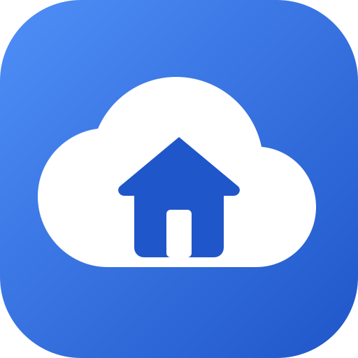

<p align="center">
  
</p>

<h1 align="center">Homelydrive</h1>

<p align="center">
  <b>Deine eigene Cloud – wie Google Drive, aber auf deinem eigenen PC.</b><br>
  Kostenlos, quelloffen, ohne Abo. Verbunden über <a href="https://tailscale.com">Tailscale</a>.
</p>

<p align="center">
  <a href="README.en.md">English</a> ·
  <a href="docs/installation.md">Installation</a> ·
  <a href="https://github.com/ErikEdits/Homelydrive/releases">Downloads</a> ·
  <a href="LICENSE">GPL-3.0</a>
</p>

---

Homelydrive besteht aus drei Teilen:

| Teil | Für | Was es macht |
|---|---|---|
| **Homelydrive Server** | Windows, Linux | Das eigentliche Cloud-Teil. Läuft als Dienst im Hintergrund und speichert alle Dateien auf deinen Festplatten. Mit Server-Fenster zum Einrichten. |
| **Homelydrive PC-App** | Windows, Linux | Lädt gewählte Ordner automatisch hoch, virtuelles Laufwerk, Symbol im Infobereich, Rechtsklick-Menü. |
| **Homelydrive Android-App** | Android 8+ | Beliebige Handy-Ordner sofort hochladen, Dateien ansehen, Dokumente scannen, Teilen-Menü. |

Alles verbindet sich über **Tailscale**: Der Server ist nur in deinem privaten Tailnet erreichbar – keine Portfreigaben, keine Domains, kein Zugriff aus dem offenen Internet.

## Funktionen

**Dateien & Weboberfläche** (im Browser, als installierbare Web-App und in der Android-App)

- Meine Ablage, geteilte Ablagen (z. B. „Familie“), „Mit mir geteilt“, eingebundene Ordner
- Hochladen ohne Größenlimit (auch 300 GB), fortsetzbar nach Abbrüchen, doppelte Dateien werden per Prüfsumme erkannt
- Gleicher Name im selben Ordner → „Datei (1).txt“, nichts wird überschrieben
- Vorschau mit Vorschaubildern: Bilder, Videos, Musik, PDF, Text
- Texteditor mit Syntaxhervorhebung und Markdown-Vorschau
- Volltextsuche (auch in PDF, Word, LibreOffice) mit Filtern nach Typ, Datum, Größe, Besitzer, Tag
- Fotos als Zeitleiste mit Diashow, Drehen und Zuschneiden
- Favoriten, zuletzt verwendet, Ordnerfarben, Tags, Notizen, Ordnergrößen, Speicherübersicht
- Papierkorb (30 Tage), Aktivitätsprotokoll, Benachrichtigungen
- Tresor mit eigenem Passwort (AES-256 verschlüsselt)
- ZIP herunterladen, ZIP auf dem Server entpacken
- Neue Dateitypen werden beim Hochladen automatisch erkannt und registriert
- WebDAV für andere Programme
- Deutsch und Englisch, heller und dunkler Modus

**Teilen**

- Mit anderen Benutzern teilen (lesen oder bearbeiten)
- Links mit Passwort, Ablaufdatum und Download-Zähler/-Limit
- Upload-Links: andere können dir Dateien schicken, ohne Konto
- Benachrichtigung, wenn jemand etwas mit dir teilt

**Server**

- Windows-Dienst bzw. systemd-Dienst, startet automatisch
- Erkennt Tailscale selbst und zeigt die Adresse für die Apps an
- Mehrere Festplatten als Speicherorte, vorhandene Ordner einbinden
- Erkennt Dateien, die direkt in den Speicherordner kopiert werden
- Mehrere Benutzer mit Speicherlimit (Standard 100 GB) – der Admin sieht keine fremden Dateien
- Profilbilder
- Protokoll, Warnung bei 90 % Speicher, Update-Hinweis
- Optional HTTPS über das Tailscale-Zertifikat, optional Docker

**PC-App**

- Ordner automatisch hochladen (nur hochladen: lokal gelöschte Dateien bleiben auf dem Server)
- Virtuelles Laufwerk (WinFsp unter Windows, FUSE unter Linux) – Dateien werden erst beim Öffnen geladen
- Manuell hoch- und herunterladen, Rechtsklick-Menü („Auf Homelydrive hochladen“, „Link kopieren“)
- Bandbreiten-Regler, Upload-Verlauf, Benachrichtigungen

**Android-App**

- Beliebige Ordner wählen (nicht nur die Kamera), jeder mit eigenem Zielordner
- Lädt neue Dateien sofort hoch, auch im Hintergrund und nach dem Neustart
- Optional: Dateien auf dem Handy nach dem Hochladen löschen
- Server-Dateien in der Android-„Dateien“-App, Teilen-Menü, Scanner zu PDF, Widget
- 100 % frei: keine Google-Dienste, F-Droid-tauglich

## Schnellstart

1. **Tailscale** auf dem Server-PC und allen Geräten installieren und im selben Konto anmelden: <https://tailscale.com/download>
2. **Server installieren** – aus den [Releases](https://github.com/ErikEdits/Homelydrive/releases):
   - Windows: `Homelydrive-Server-Setup-x.y.z.exe`
   - Linux: `homelydrive-server_x.y.z_amd64.deb` (oder das AppImage)
3. Im **Server-Fenster** das erste Konto anlegen (wird Admin). Dort steht auch die Adresse, z. B. `http://mein-pc:8420`.
4. **Apps verbinden**: PC-App (`Homelydrive-Setup-x.y.z.exe`, `.deb` oder AppImage) bzw. Android-App (`Homelydrive-x.y.z.apk`) installieren und die Adresse eingeben – oder einfach im Browser öffnen.

Die ausführliche Anleitung Schritt für Schritt steht in **[docs/installation.md](docs/installation.md)**.

## Downloads

| Datei | Für |
|---|---|
| `Homelydrive-Server-Setup-x.y.z.exe` | Server für Windows (Installer, richtet den Dienst ein) |
| `Homelydrive-Setup-x.y.z.exe` | PC-App für Windows (bringt WinFsp für das Laufwerk mit) |
| `homelydrive-server_x.y.z_amd64.deb` | Server für Debian/Ubuntu/Mint |
| `homelydrive_x.y.z_amd64.deb` | PC-App für Debian/Ubuntu/Mint |
| `Homelydrive-Server-x.y.z-x86_64.AppImage` | Server für andere Linux-Systeme |
| `Homelydrive-x.y.z-x86_64.AppImage` | PC-App für andere Linux-Systeme |
| `Homelydrive-x.y.z.apk` | Android-App |
| `homelydrive-x.y.z-*-portable.zip` / `.tar.gz` | Programme ohne Installer |
| `ghcr.io/erikedits/homelydrive` | Server als Docker-Container (optional, siehe [docs/docker.md](docs/docker.md)) |

## Selbst bauen

Siehe [docs/building.md](docs/building.md). Kurz: Go 1.26, Node.js 22 und – für die PC-App unter Linux – `libfuse-dev`:

```sh
scripts/build.sh            # Server + PC-App für diesen PC nach dist/
cd android && ./gradlew assembleDebug
```

## Aufbau des Projekts

```
cmd/homelydrive-server   Server (Go)           internal/server   Kern, API, WebDAV, Tailscale
cmd/homelydrive          PC-App (Go)           internal/client   Upload, Laufwerk, Tray
web/                     Weboberfläche (Svelte) – in Server und PC-App eingebaut
android/                 Android-App (Kotlin, nur Android-Framework)
packaging/               Installer, .deb, AppImage     .github/workflows   CI und Releases
```

## Lizenz

Homelydrive ist freie Software unter der [GNU General Public License v3.0](LICENSE).
